<table>
  <tr>
    <td align="center" valign="top">
      
    </td>
    <td valign="top">
      
<pre>
<b> ____  </b>   richard@github
<b>|  _ \ </b>   --------------
<b>| |_) |</b>   role       ads student
<b>|  _ &lt; </b>   from       brazil
<b>|_| \_\</b>   stack      java, javascript, html, css
<b>       </b>   tools      git, github
<b>       </b>   ide        jetbrains, visual studio code
<b>       </b>   motto      learn by building, even when it
<b>       </b>              breaks ten times first
<b>       </b>   seeking    first internship in software
<b>       </b>              development
<b>       </b>   hobbies    game projects, music
<b>       </b>   contact    <a href="https://www.linkedin.com/in/richard-spinola/">linkedin</a>
</pre>
    </td>
  </tr>
</table>

<pre>
<b>▸ projects ─────────────────────────────────── ▸ languages · activity ──────────────────────────────────────────</b>
</pre>

<table>
  <tr>
    <td valign="top">
<pre>
<b>~/projects</b><!--P-->
├── own/
│   └── <a href="https://github.com/RichardSpinola/simulador-carrinho-compras-java">simulador-carrinho-compras-java</a>
├── college/
│   ├── <a href="https://github.com/RichardSpinola/ProjetoFinalFrontEnd">ProjetoFinalFrontEnd</a>
│   ├── <a href="https://github.com/RichardSpinola/ProjetoFinalSO">ProjetoFinalSO</a>
│   └── <a href="https://github.com/RichardSpinola/Faculdade">Faculdade</a>
└── ai-assisted/
    ├── <a href="https://github.com/RichardSpinola/berthline">berthline</a>
    ├── <a href="https://github.com/RichardSpinola/makebench">makebench</a>
    └── <a href="https://github.com/RichardSpinola/OpenStudyHub">OpenStudyHub</a><!--/P-->
</pre>
    </td>
    <td valign="top">
<pre>
<b>$ top-languages</b><!--L-->
(written by me)
Java       <b>███████████████</b>░░░░░░░░░  63.6%
HTML       <b>███████</b>░░░░░░░░░░░░░░░░░  28.4%
CSS        <b>██</b>░░░░░░░░░░░░░░░░░░░░░░   8.0%
(ai-assisted)
TypeScript <b>████████████</b>░░░░░░░░░░░░  51.4%
Python     <b>█████████</b>░░░░░░░░░░░░░░░  36.8%
CSS        <b>██</b>░░░░░░░░░░░░░░░░░░░░░░   7.3%
JavaScript <b>█</b>░░░░░░░░░░░░░░░░░░░░░░░   4.1%
Shell      <b></b>░░░░░░░░░░░░░░░░░░░░░░░░   0.2%
other      <b></b>░░░░░░░░░░░░░░░░░░░░░░░░   0.2%<!--/L-->
────────────────────────────────────────────────────
<b>$ git contributions</b><!--A-->
418 contributions · last 24 weeks
    May Jun     Jul     Aug       Sep     Oct     Nov
      · · · · · · · · · · · · · · · · · ░ · · · ▓ ░ ·
Mon   · · · · · · · · · · · · · · · · ░ · · · · ▒ ░ ·
      · · · · · ▒ · · · · ░ · · · · · · · · ░ · · · █
Wed   · · · · · · · · · · · · · · · · ░ · · ░ ░ █ · ·
    · · · · · · ░ · · · · · ░ · · · · · · · ░ ░ ▒ ░
Fri · · · · · · · · · · ░ · · · · · · · · · ░ ░ · ▓
    · · · · · · · · · · · · · · · · · ░ · · ░ ░ ░ ░
    less · ░ ▒ ▓ █ more<!--/A-->
</pre>
    </td>
  </tr>
</table>

<pre>
<b>────────────────────────────────────────────────────────────────────────────────────────────────────────────────</b>
</pre>

<!-- email: <a href="mailto:SEU-EMAIL-AQUI">email</a> -->
